# Kindling: a from-scratch game engine and game jam template

**Build games from scratch: a zero-dependency 2D + 3D JavaScript game engine, game jam template, and interactive visual lessons.**

[](LICENSE)
[](https://github.com/Normansrule/kindling/releases)
[](https://github.com/Normansrule/kindling/actions/workflows/pages.yml)
[](package.json)
[](https://github.com/Normansrule/kindling/commits/main)

Plain JavaScript (ES modules), Canvas 2D, raw WebGL 2 (Web Graphics Library 2) and Web Audio. No dependencies, no frameworks, no build step. Plus complete reference games in Python, Rust and React. Every engine module has a doc page and an interactive visualization, so you can learn how a game engine works and then ship a game in a weekend jam.

**Play in the browser:** <https://normansrule.github.io/kindling/>

<p align="center">
  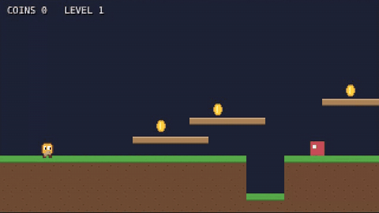
  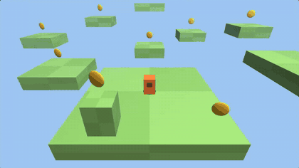
</p>
<p align="center">
  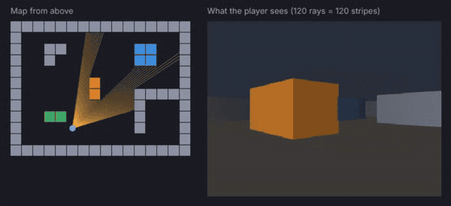
</p>

## Quick start (WSL Ubuntu, macOS or Linux)

```bash
mkdir -p ~/projects && cd ~/projects && git clone https://github.com/Normansrule/kindling.git && cd kindling && python3 -m http.server 8000
```

Open <http://localhost:8000/>. Do not double-click `index.html`: browsers block modules on `file://` ([why](docs/RUNNING.md)).

Run the tests: `cd ~/projects/kindling && node --test tests/node.test.js` (Node 20 or newer), or open <http://localhost:8000/tests/>.

## What's inside

| | |
|---|---|
| **Engine** ([`engine/`](engine/)) | 45 small modules: fixed-timestep loop, scenes, input (keyboard, mouse, touch, gamepad, actions), math, sprites, collision (AABB and SAT), platformer physics, tilemaps, camera, particles, tweens, Web Audio sound effects, and a WebGL 2 renderer with Phong lighting, OBJ loading, textures, 3D collision and a raycaster |
| **Samples** ([`samples/`](samples/)) | 11 complete small games: 6 in 2D, 5 in 3D |
| **Visualizations** ([`viz/`](viz/)) | 13 interactive pages, one per engine idea, with sliders and play/pause |
| **Lessons** ([`lessons/`](lessons/)) | 13 lessons in three tracks (2D, 3D, game design), each with an exercise and a solution |
| **Jam kit** ([`jam/`](jam/)) | A starter game, a one-command `new-game.sh`, a scope cutter, checklists, and an itch.io upload guide |
| **Reference games** ([`references/`](references/)) | 11 complete games and demos in Python (pygame-ce), Rust (macroquad) and React (react-three-fiber), with tests |
| **Language bridges** ([`docs/bridges/`](docs/bridges/)) | The core ideas in plain Python, React and Rust, standard library only |

### Samples

| | | |
|---|---|---|
| [](samples/2d/01-pong/) [Pong](samples/2d/01-pong/) | [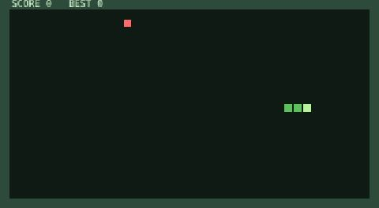](samples/2d/02-snake/) [Snake](samples/2d/02-snake/) | [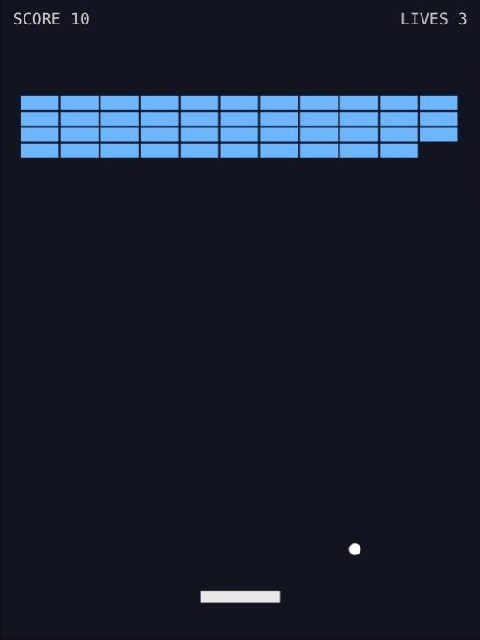](samples/2d/03-breakout/) [Breakout](samples/2d/03-breakout/) |
| [](samples/2d/04-platformer/) [Platformer](samples/2d/04-platformer/) | [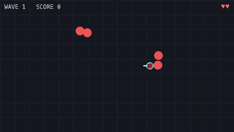](samples/2d/05-top-down-shooter/) [Top-down shooter](samples/2d/05-top-down-shooter/) | [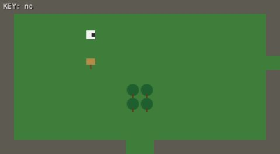](samples/2d/06-tilemap-room/) [Tilemap room](samples/2d/06-tilemap-room/) |
| [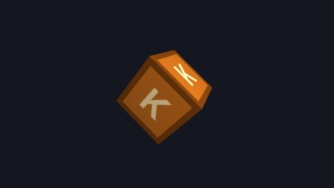](samples/3d/01-spinning-cube/) [Spinning cube](samples/3d/01-spinning-cube/) | [](samples/3d/02-lit-scene/) [Lit scene](samples/3d/02-lit-scene/) | [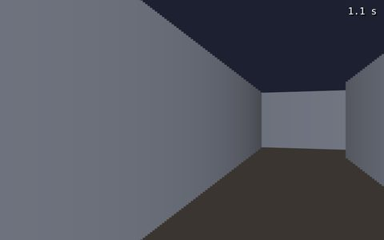](samples/3d/03-raycaster-maze/) [Raycaster maze](samples/3d/03-raycaster-maze/) |
| [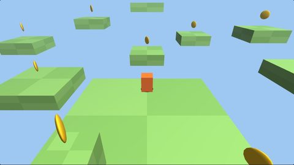](samples/3d/04-coin-collector/) [Coin collector](samples/3d/04-coin-collector/) | [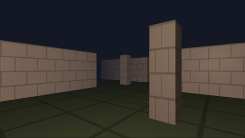](samples/3d/05-first-person-walk/) [First-person walk](samples/3d/05-first-person-walk/) | |

## Learning paths

1. **New to game code?** Start with [lesson 2D-1, the game loop](https://normansrule.github.io/kindling/lessons/2d-1-game-loop.html), then follow the 2D track to platformer physics and juice.
2. **Want 3D?** After the 2D track, do [3D-1 transforms](https://normansrule.github.io/kindling/lessons/3d-1-transforms.html) through [3D-4 first person](https://normansrule.github.io/kindling/lessons/3d-4-first-person.html).
3. **Have a jam coming up?** Read [design-1, scope](https://normansrule.github.io/kindling/lessons/design-1-scope.html), then [`jam/README.md`](jam/README.md).
4. **Looking something up?** Use the [cheatsheet](docs/CHEATSHEET.md), the [glossary](docs/GLOSSARY.md) and the [module docs](docs/modules/).

## Coming from Python, Rust or React

[`references/`](references/) has complete games built with each language's favourite game library, so you can read the same idea three or four ways:

| [Python (pygame-ce)](references/python/) | [Rust (macroquad)](references/rust/) | [React (react-three-fiber)](references/react/) |
|---|---|---|
| [](references/python/) | [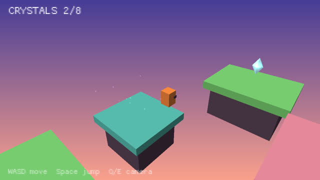](references/rust/) | [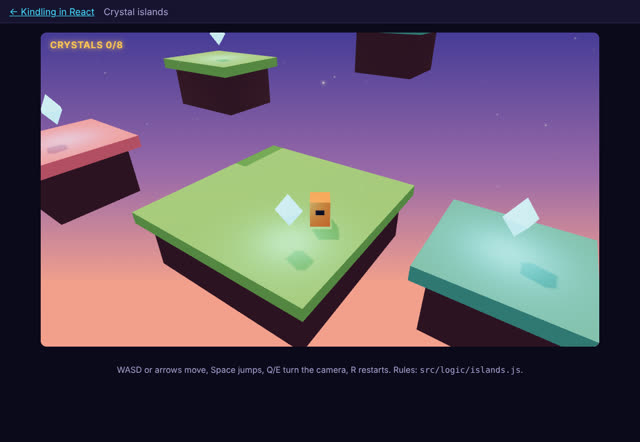](references/react/) |
| Neon platformer, Neon arena, Raycast halls, Fireworks | Neon platformer, Crystal islands 3D, Raycast halls, Fireworks | Neon arena, Crystal islands 3D, Easing playground ([play](https://normansrule.github.io/kindling/references/react/dist/)) |

```bash
cd ~/projects/kindling/references/python && python3 -m venv .venv && . .venv/bin/activate && pip install -r requirements.txt && python -m games.neon_platformer
```

The engine itself stays zero-dependency; only `references/` uses packages. For the ideas with no libraries at all, read the [bridges](docs/bridges/): [Python](docs/bridges/python.md), [React](docs/bridges/react.md), [Rust](docs/bridges/rust.md).

## How pages import the engine

```html
<script type="importmap">
  { "imports": { "kindling/": "../../engine/" } }
</script>
<script type="module">
  import { createGame } from "kindling/game.js";
</script>
```

The path is relative to the page, so it works locally, on GitHub Pages and on itch.io. Details: [docs/RUNNING.md](docs/RUNNING.md).

## Make a jam game

```bash
cd ~/projects/kindling && bash jam/new-game.sh my-jam-game && cd ~/projects/my-jam-game && python3 -m http.server 8000
```

This copies the starter and the engine into a new folder that you own. When you are done, `cd ~/projects/kindling && bash jam/zip-game.sh ~/projects/my-jam-game` makes `my-jam-game.zip`, ready for itch.io ([guide](jam/SUBMIT-TO-ITCH.md)).

Jams have different rules about pre-made engines and AI-assisted tools. Read your jam's rules first. Kindling is public and was built with AI help; disclose that if a jam asks.

## Docs map

| Page | Read it for |
|---|---|
| [ARCHITECTURE](docs/ARCHITECTURE.md) | How the modules fit together, with diagrams |
| [RUNNING](docs/RUNNING.md) | Local server, import maps, `file://` |
| [modules/](docs/modules/) | One page per engine area |
| [CHEATSHEET](docs/CHEATSHEET.md) | Every public function on one page |
| [GLOSSARY](docs/GLOSSARY.md) | Game and graphics terms in plain words |
| [RESOURCES](docs/RESOURCES.md) | Free, checked links for art, sound and learning |
| [DECISIONS](docs/DECISIONS.md) | Why things are the way they are |
| [references/](references/README.md) | Same game, three languages: a side-by-side map |
| [REBUILD](docs/REBUILD.md) | Rebuild Kindling yourself, stage by stage |

## Roadmap

| Stage | What | Status |
|---|---|---|
| S0 | Repo skeleton, landing page, import-map pattern, Pages deploy | done |
| S1 | Core: loop, time, scene, events, math, input, canvas, debug overlay | done |
| S2 | 2D systems: sprites, animation, collision, physics, tilemap, camera, particles, audio | done |
| S3 | 2D samples: pong, snake, breakout, platformer, top-down shooter, tilemap room | done |
| S4 | 3D pipeline: WebGL 2, shaders, meshes, OBJ loader, camera, Phong lighting, textures | done |
| S5 | 3D samples: spinning cube, lit scene, raycaster maze, coin collector, first-person walk | done |
| S6 | Lessons, cheatsheets, exercises, language bridges | done |
| S7 | Jam kit and resources | done |
| S8 | Polish and v1.0.0 | done |
| + | Reference games in Python, Rust and React | done |

After 1.0: a "13k path" for js13k-sized games, sprite-sheet packing, a tiny level editor, and more lessons. Ideas welcome in [Discussions](https://github.com/Normansrule/kindling/discussions).

## Contributing

Read [CONTRIBUTING.md](CONTRIBUTING.md). Issues labelled [good first issue](https://github.com/Normansrule/kindling/labels/good%20first%20issue) are a good place to start. Please follow the [Code of Conduct](CODE_OF_CONDUCT.md), and report security problems privately ([SECURITY.md](SECURITY.md)).

## License and citation

[MIT](LICENSE). Sample art is drawn in code; any third-party assets list their source and license next to them. To cite Kindling, use [CITATION.cff](CITATION.cff) (GitHub shows a "Cite this repository" button).
