<p align="center">
  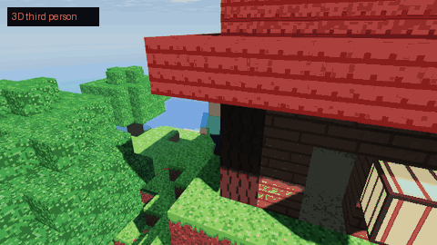
</p>

<h1 align="center">Kindling</h1>

<p align="center"><strong>Build games from scratch in 2D, 2.5D and 3D.</strong><br>
A zero-dependency JavaScript game engine with its own WebGL 2 renderer, a scene editor and<br>character designer, eight genre templates, a live code playground, 35 game code examples and lessons.</p>

<p align="center">
  <a href="https://normansrule.github.io/video-game-kindling/"><strong>Website</strong></a> ·
  <a href="https://normansrule.github.io/video-game-kindling/playground/"><strong>Playground</strong></a> ·
  <a href="game-code-examples/"><strong>Game Code Examples</strong></a> ·
  <a href="https://normansrule.github.io/video-game-kindling/templates/"><strong>Templates</strong></a> ·
  <a href="https://normansrule.github.io/video-game-kindling/make/"><strong>Editors</strong></a> ·
  <a href="https://normansrule.github.io/video-game-kindling/library/"><strong>Library</strong></a> ·
  <a href="samples/"><strong>Samples</strong></a> ·
  <a href="https://normansrule.github.io/video-game-kindling/viz/"><strong>Visualizations</strong></a> ·
  <a href="docs/"><strong>Docs</strong></a>
</p>

<p align="center">
  <a href="LICENSE"></a>
  <a href="https://github.com/Normansrule/video-game-kindling/releases"></a>
  <a href="https://github.com/Normansrule/video-game-kindling/actions/workflows/pages.yml"></a>
  <a href="package.json"></a>
  
</p>

Plain JavaScript (ES modules), Canvas 2D, raw WebGL 2 (Web Graphics Library 2) and Web Audio. No frameworks, no npm install, no build step: open a page and it runs. Every file starts with a comment that says **what** it does and **why**, so you can learn how a game engine works and then ship a game in a weekend jam.

## One world, five views

Keep your game in plain data, and choose how it is drawn at the end. The same block world can be shown five ways, and you can switch while the game runs:

| Mode | What you see | Drawn with |
|---|---|---|
| `"2d"` | Top-down map, like a classic adventure game | Canvas 2D |
| `"iso"` | Isometric diorama | Canvas 2D, painter's algorithm |
| `"raycast"` | Retro first person, like early 90s shooters | Canvas 2D pixel buffer, one ray per column |
| `"3d"` | Third person behind a blocky hero | WebGL 2 |
| `"3d-fps"` | First person | WebGL 2 |

```js
import { createVoxelWorld } from "kindling/world/voxel-world.js";
import { generateIsland } from "kindling/world/generate.js";
import { createWorldView } from "kindling/views/world-view.js";

const world = createVoxelWorld(64, 40, 64);
const island = generateIsland(world, { seed: 3 });
const view = createWorldView({ container: "#stage", world, mode: "3d" });
view.setMode("iso");   // or "2d", "raycast", "3d-fps"
```

The stylized 3D renderer is written from scratch in about 1,100 lines on top of the WebGL basics: chunked block meshes with hidden-face culling, per-corner ambient occlusion, a sun shadow map with soft edges, sky light, hemisphere ambient, tone mapping, fog, water with reflections, a sky with clouds and stars, a day–night cycle, lantern lights, flat-shaded low-poly models and an animated blocky character. Blocky and stylized, in the spirit of Minecraft and Roblox, with every texture painted in code.

<p align="center">
  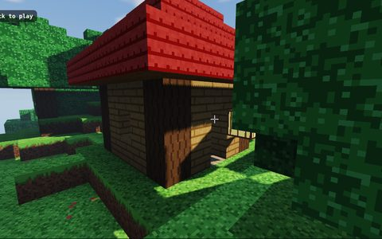
  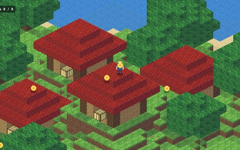
  
</p>

## Editors, a library and templates

Design with tools when that is faster, write code when you want control. Everything the tools make is a small JSON file the engine reads, so the two always mix.

- **[Scene editor](https://normansrule.github.io/video-game-kindling/make/scene-editor/)**: laid out like Unity. Paint levels from a palette of 95 tiles, drop in prefabs (player, slimes, bats, skeletons, keys, doors, springs, villagers), select anything to edit its components in the inspector, undo anything, and press **Play**.
- **[Character designer](https://normansrule.github.io/video-game-kindling/make/character-designer/)**: hair, clothes, hats, faces, capes, wings and gear in any color. One spec becomes a 3D model and a 2D sprite sheet with walk cycles in four directions.
- **[Templates](templates/)**: platformer, top-down adventure, endless runner, block-push puzzle, tower defense, match three, turn-based battle and 3D adventure. Copy a folder and make it yours.
- **[Library](https://normansrule.github.io/video-game-kindling/library/)**: 95 tiles, 40 blocks, 31 sprites and endless characters, all painted by code and free to use (CC0), each with the line of code that uses it.

```js
import { runScene } from "kindling/scene/runtime.js";
const scene = await (await fetch("./scene.json")).json();   // made in the scene editor
runScene(scene, { canvas: "#game" });                         // that's the whole game
```

<p align="center">
  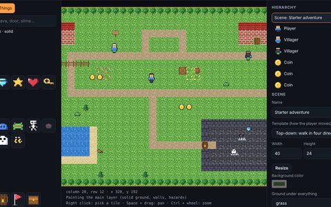
  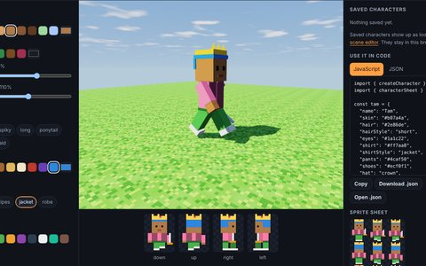
  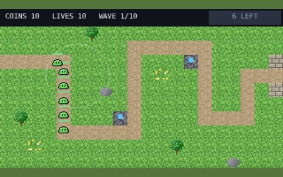
</p>

## Quick start (WSL Ubuntu, macOS or Linux)

```bash
mkdir -p ~/projects && cd ~/projects && git clone https://github.com/Normansrule/video-game-kindling.git kindling && cd kindling && python3 -m http.server 8000
```

Open <http://localhost:8000/>. Do not double-click `index.html`: browsers block modules on `file://` ([why](docs/RUNNING.md)).

Run the tests: `cd ~/projects/kindling && node --test tests/node.test.js` (Node 20 or newer), or open <http://localhost:8000/tests/>.

## Game Code Examples

[`game-code-examples/`](game-code-examples/) holds 35 short, runnable programs: every kind of code you need to start a game. Open any of them in the [playground](https://normansrule.github.io/video-game-kindling/playground/), change a number, and watch it change.

| Topic | Examples |
|---|---|
| **Start here** | hello canvas · game loop and delta time · keyboard movement · mouse and touch · gamepad · scenes and menus · timers and tweens |
| **Gameplay** | sprites and animation · box collision · circles and SAT · platformer physics · top-down tilemap · camera follow and shake · particles and juice · enemy AI state machine · A* pathfinding · procedural noise maps · object pools · enemy waves |
| **Sound, saving and UI** | sound effects from code · music sequencer · save and load · HUD and buttons · dialogue with choices · inventory grid |
| **2.5D views** | isometric world · raycaster first person · switch 2D, 2.5D and 3D |
| **3D** | hello cube · block world with shadows · low-poly models · first-person controls · day and night · break and place blocks · write your own shader |

<p align="center">
  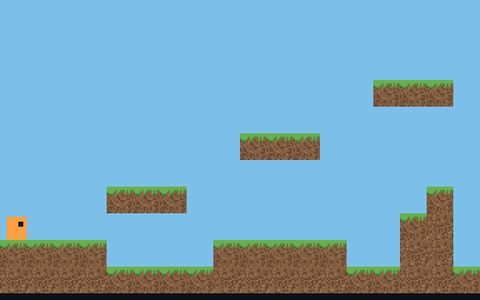
  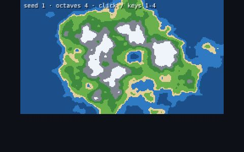
  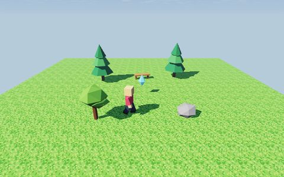
  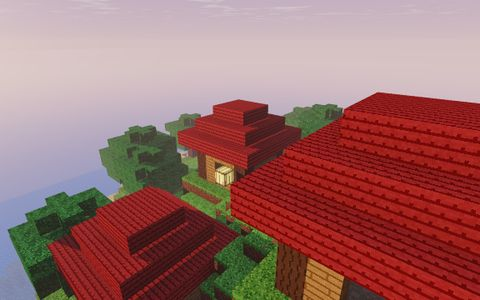
</p>

## What's inside

| | |
|---|---|
| **Engine** ([`engine/`](engine/)) | 82 small modules: loop, scenes, input (keyboard, mouse, touch, gamepad, actions), math and noise, sprites, collision (AABB and SAT), platformer physics, tilemaps, cameras, particles, tweens, Web Audio, block worlds, five views, a WebGL 2 renderer, characters, scenes with components and prefabs, and an art library |
| **Playground** ([`playground/`](playground/)) | A CodePen-style editor: code on the left, the game on the right, console underneath |
| **Game Code Examples** ([`game-code-examples/`](game-code-examples/)) | 35 runnable snippets, with a gallery and thumbnails |
| **Templates** ([`templates/`](templates/)) | 8 genre starters: platformer, top-down adventure, runner, push puzzle, tower defense, match three, turn-based battle, 3D adventure |
| **Library** ([`library/`](library/)) | 95 tiles, 40 blocks, 31 sprites and random characters, all painted by code (CC0), with copyable code |
| **Samples** ([`samples/`](samples/)) | 13 complete small games: 6 in 2D, 6 in 3D, and one in all five views |
| **Visualizations** ([`viz/`](viz/)) | 15 interactive pages, one per engine idea, with sliders and play/pause |
| **Lessons** ([`lessons/`](lessons/)) | 13 lessons in three tracks (2D, 3D, game design), each with an exercise and a solution |
| **Jam kit** ([`jam/`](jam/)) | A starter game, a one-command `new-game.sh`, a scope cutter, checklists, and an itch.io upload guide |
| **Editors** ([`make/`](make/)) | A [scene editor](https://normansrule.github.io/video-game-kindling/make/scene-editor/) with a palette, hierarchy, inspector and Play, a [character designer](https://normansrule.github.io/video-game-kindling/make/character-designer/), a text [level editor](https://normansrule.github.io/video-game-kindling/make/level-editor/) with play-testing and a [sprite packer](https://normansrule.github.io/video-game-kindling/make/sprite-packer/) |
| **13k path** ([`tiny/`](tiny/)) | A 2 KB engine and a complete starter game ([Spark Hop](https://normansrule.github.io/video-game-kindling/tiny/starter/)) for js13kGames |
| **Reference games** ([`references/`](references/)) | 11 complete games and demos in Python (pygame-ce), Rust (macroquad) and React (react-three-fiber) |
| **Language bridges** ([`docs/bridges/`](docs/bridges/)) | The core ideas in plain Python, React and Rust |

### Samples

| | | |
|---|---|---|
| [](samples/modes/01-one-world/) [One world, five views](samples/modes/01-one-world/) | [](samples/3d/06-island-builder/) [Island builder](samples/3d/06-island-builder/) | [](samples/3d/04-coin-collector/) [Coin collector](samples/3d/04-coin-collector/) |
| [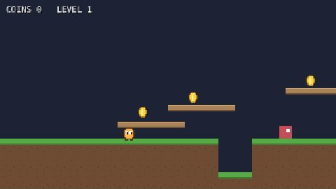](samples/2d/04-platformer/) [Platformer](samples/2d/04-platformer/) | [](samples/2d/06-tilemap-room/) [Tilemap adventure](samples/2d/06-tilemap-room/) | [](samples/2d/05-top-down-shooter/) [Top-down shooter](samples/2d/05-top-down-shooter/) |
| [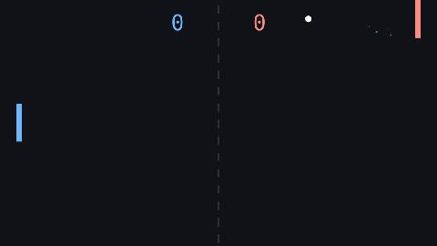](samples/2d/01-pong/) [Pong](samples/2d/01-pong/) | [](samples/2d/02-snake/) [Snake](samples/2d/02-snake/) | [](samples/2d/03-breakout/) [Breakout](samples/2d/03-breakout/) |
| [](samples/3d/03-raycaster-maze/) [Raycaster maze](samples/3d/03-raycaster-maze/) | [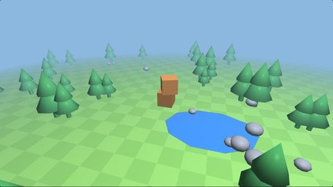](samples/3d/02-lit-scene/) [Lit scene](samples/3d/02-lit-scene/) | [](samples/3d/05-first-person-walk/) [First-person walk](samples/3d/05-first-person-walk/) |

## Learning paths

1. **New to game code?** Start with [lesson 2D-1, the game loop](https://normansrule.github.io/video-game-kindling/lessons/2d-1-game-loop.html), then follow the 2D track to platformer physics and juice.
2. **Want 3D?** After the 2D track, do [3D-1 transforms](https://normansrule.github.io/video-game-kindling/lessons/3d-1-transforms.html) through [3D-4 first person](https://normansrule.github.io/video-game-kindling/lessons/3d-4-first-person.html).
3. **Have a jam coming up?** Read [design-1, scope](https://normansrule.github.io/video-game-kindling/lessons/design-1-scope.html), then [`jam/README.md`](jam/README.md).
4. **Looking something up?** Use the [cheatsheet](docs/CHEATSHEET.md), the [glossary](docs/GLOSSARY.md) and the [module docs](docs/modules/).

## Coming from Python, Rust or React

[`references/`](references/) has complete games built with each language's favourite game library, so you can read the same idea three or four ways:

| [Python (pygame-ce)](references/python/) | [Rust (macroquad)](references/rust/) | [React (react-three-fiber)](references/react/) |
|---|---|---|
| [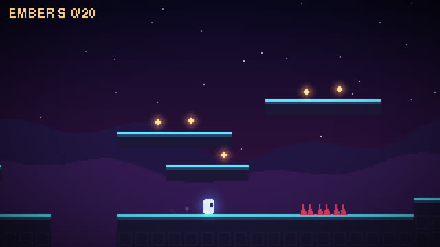](references/python/) | [](references/rust/) | [](references/react/) |
| Neon platformer, Neon arena, Raycast halls, Fireworks | Neon platformer, Crystal islands 3D, Raycast halls, Fireworks | Neon arena, Crystal islands 3D, Easing playground ([play](https://normansrule.github.io/video-game-kindling/references/react/dist/)) |

```bash
cd ~/projects/kindling/references/python && python3 -m venv .venv && . .venv/bin/activate && pip install -r requirements.txt && python -m games.neon_platformer
```

The engine itself stays zero-dependency; only `references/` uses packages. For the ideas with no libraries at all, read the [bridges](docs/bridges/): [Python](docs/bridges/python.md), [React](docs/bridges/react.md), [Rust](docs/bridges/rust.md).

## How pages import the engine

```html
<script type="importmap">
  { "imports": { "kindling/": "../../engine/" } }
</script>
<script type="module">
  import { createGame } from "kindling/game.js";
</script>
```

The path is relative to the page, so it works locally, on GitHub Pages and on itch.io. Details: [docs/RUNNING.md](docs/RUNNING.md).

## Make a jam game

```bash
cd ~/projects/kindling && bash jam/new-game.sh my-jam-game && cd ~/projects/my-jam-game && python3 -m http.server 8000
```

This copies the starter and the engine into a new folder that you own. When you are done, `cd ~/projects/kindling && bash jam/zip-game.sh ~/projects/my-jam-game` makes `my-jam-game.zip`, ready for itch.io ([guide](jam/SUBMIT-TO-ITCH.md)).

Draw levels in the [level editor](make/level-editor/) and pack your art with the [sprite packer](make/sprite-packer/). Entering js13kGames? Start from [`tiny/`](tiny/) instead: `cd ~/projects/kindling && bash tiny/new-tiny-game.sh my-tiny-game`.

Jams have different rules about pre-made engines and AI-assisted tools. Read your jam's rules first. Kindling is public and was built with AI help; disclose that if a jam asks.

## Docs map

| Page | Read it for |
|---|---|
| [ARCHITECTURE](docs/ARCHITECTURE.md) | How the modules fit together, with diagrams |
| [RUNNING](docs/RUNNING.md) | Local server, import maps, `file://` |
| [modules/](docs/modules/) | One page per engine area |
| [CHEATSHEET](docs/CHEATSHEET.md) | Every public function on one page |
| [GLOSSARY](docs/GLOSSARY.md) | Game and graphics terms in plain words |
| [RESOURCES](docs/RESOURCES.md) | Free, checked links for art, sound and learning |
| [DECISIONS](docs/DECISIONS.md) | Why things are the way they are |
| [references/](references/README.md) | Same game, three languages: a side-by-side map |
| [REBUILD](docs/REBUILD.md) | Rebuild Kindling yourself, stage by stage |

## Roadmap

| Stage | What | Status |
|---|---|---|
| S0 | Repo skeleton, landing page, import-map pattern, Pages deploy | done |
| S1 | Core: loop, time, scene, events, math, input, canvas, debug overlay | done |
| S2 | 2D systems: sprites, animation, collision, physics, tilemap, camera, particles, audio | done |
| S3 | 2D samples: pong, snake, breakout, platformer, top-down shooter, tilemap room | done |
| S4 | 3D pipeline: WebGL 2, shaders, meshes, OBJ loader, camera, Phong lighting, textures | done |
| S5 | 3D samples: spinning cube, lit scene, raycaster maze, coin collector, first-person walk | done |
| S6 | Lessons, cheatsheets, exercises, language bridges | done |
| S7 | Jam kit and resources | done |
| S8 | Polish and v1.0.0 | done |
| + | Reference games in Python, Rust and React | done |
| 1.1 | 13k path, sprite packer and texture atlases, level editor with play-testing | done |
| 2.0 | Own stylized 3D engine, block worlds, five view modes, playground, 35 Game Code Examples, new site | done |
| 2.1 | Scene editor, character designer, components and prefabs, art library (95 tiles, 40 blocks, 31 sprites), 8 genre templates | done |

Next: lessons for the block-world engine, greedy meshing for bigger worlds, more lessons (one per make tool), sprite trimming in the packer, and custom tile legends saved with a level. Ideas welcome in [Discussions](https://github.com/Normansrule/video-game-kindling/discussions).

## Contributing

Read [CONTRIBUTING.md](CONTRIBUTING.md). Issues labelled [good first issue](https://github.com/Normansrule/video-game-kindling/labels/good%20first%20issue) are a good place to start. Please follow the [Code of Conduct](CODE_OF_CONDUCT.md), and report security problems privately ([SECURITY.md](SECURITY.md)).

## License and citation

[MIT](LICENSE). Sample art is drawn in code; any third-party assets list their source and license next to them. To cite Kindling, use [CITATION.cff](CITATION.cff) (GitHub shows a "Cite this repository" button).
