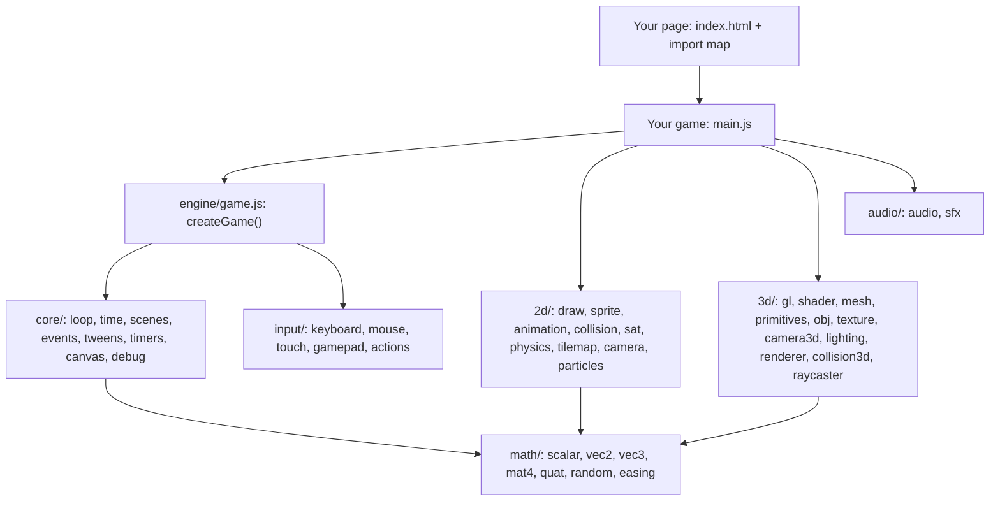

# Architecture

How Kindling fits together, in one page. If you only read one engine file, read [`engine/game.js`](../engine/game.js); it wires everything below.

## Layers



Arrows mean "imports". Lower layers never import higher ones: `math/` imports nothing, `core/` never imports `2d/`, and nothing in `engine/` imports your game. That keeps every file testable on its own.

## Rules every engine file follows

1. **One concept per file, under about 300 lines.** If a file grows, split the idea.
2. **A top comment:** WHAT it is, WHY it exists, and where its DOC lives.
3. **Factories, not classes:** `createThing(options)` returns a plain object. No `this`, no `new`, no inheritance to trace.
4. **Plain names:** `stepSeconds`, not `dt`; `velocityX`, not `vx`.
5. **No dependencies and no build step.** Plain ES (ECMAScript) modules that browsers load directly.

## How a page finds the engine: import maps

Every HTML page maps the prefix `kindling/` to the engine folder, relative to that page:

```html
<script type="importmap">
  { "imports": { "kindling/": "../../../engine/" } }
</script>
<script type="module" src="./main.js"></script>
```

Game code then writes `import { createGame } from "kindling/game.js"` no matter where it lives. Engine files import each other with relative paths (`../math/vec2.js`), so the engine works under any folder, including GitHub Pages at `/video-game-kindling/` and a game jam zip. See [DECISIONS.md](DECISIONS.md) D1.

## One frame

```mermaid
sequenceDiagram
  participant Browser
  participant Loop as core/loop.js
  participant Game as game.js
  participant Scene as your scene
  Browser->>Loop: requestAnimationFrame(now)
  Loop->>Loop: accumulator += frame time (clamped to 0.25 s)
  loop while accumulator >= step
    Loop->>Game: update(step)
    Game->>Game: gamepad.update(), tweens, timers
    Game->>Scene: update(game, step)
    Game->>Game: endStep() on every input device
  end
  Loop->>Game: render(alpha)
  Game->>Scene: render(game, context, alpha)
```

## Where things live

| Folder | What | Who reads it |
|---|---|---|
| `engine/` | The engine. Zero dependencies. | Games import it. |
| `samples/` | Complete small games, one `main.js` each. | You, to learn and copy from. |
| `viz/` | Interactive visualizations, one idea each. `viz/kit.js` is page UI only; games never import it. | You, to see an idea move. |
| `lessons/` | Explanation, visualization, walkthrough, exercise, checklist. | You, in order. |
| `docs/` | One page per engine module, plus this file, cheat sheet, glossary, language bridges. | Reference. |
| `jam/` | Starter template, `new-game.sh`, checklists, itch.io guide. | You, at the start of a jam. |
| `tests/` | `tests/checks/*.checks.js`, run in the browser (`tests/index.html`) and in Node (`node --test tests/node.test.js`). | You and the GitHub Actions workflow. |
| `tools/smoke/` | Development-only Playwright check: every page loads with no errors at 390 px. Never shipped in a game. | You, before a release. |
