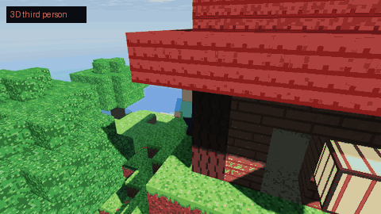

# Kindling v2.0.0

**Our own graphics engine, in 2D, 2.5D and 3D.** Kindling 2 adds a stylized 3D renderer written from scratch in raw WebGL 2, block worlds that can be drawn five different ways, a CodePen-style playground and 35 Game Code Examples. Still no dependencies and no build step.

## Highlights

- **One world, five views.** `createWorldView({ world, mode })` draws the same block world as a 2D map, an isometric diorama, a retro raycaster, 3D third person or 3D first person. `view.setMode("iso")` switches while the game runs. ([play](https://normansrule.github.io/video-game-kindling/samples/modes/01-one-world/))
- **A stylized 3D renderer.** Blocky in the spirit of Minecraft and Roblox, made to look good with light: soft sun shadows, ambient occlusion in every crease, sky light, fog, see-through water, a sky with clouds and stars, a day–night cycle and glowing lanterns. Every texture is painted by code. ([see each effect](https://normansrule.github.io/video-game-kindling/viz/15-voxel-lighting/))
- **Playground.** Code on the left, the game on the right, console underneath. Change a number and watch it change. ([open it](https://normansrule.github.io/video-game-kindling/playground/))
- **35 Game Code Examples.** Every kind of code you need to start a game, from the first canvas to break-and-place blocks and writing your own shader. ([browse](https://normansrule.github.io/video-game-kindling/game-code-examples/))
- **Island builder.** A first-person sample: break and place blocks, nine-block hotbar, day and night, save and load. ([play](https://normansrule.github.io/video-game-kindling/samples/3d/06-island-builder/))
- **A new site.** A live demo on the landing page that tours all five views, and new galleries for examples and samples.

## Try it

- Online: <https://normansrule.github.io/video-game-kindling/>
- Locally: `mkdir -p ~/projects && cd ~/projects && git clone https://github.com/Normansrule/video-game-kindling.git kindling && cd kindling && python3 -m http.server 8000`, then open <http://localhost:8000/>

## Upgrading from 1.x

Nothing was removed. Every 1.x module, sample and lesson works the same way; the new code lives in new folders (`engine/world/`, `engine/views/`) and new files in `engine/3d/`. `shader.js` and `mesh.js` gained one more vertex attribute and texture-array uniforms, which older code doesn't use.

## Known limits

- Worlds are meshed one face at a time (no greedy meshing), so very large worlds (over about 128 × 128 columns) take a moment to build. Chunks only rebuild where you edit.
- The isometric view redraws the whole island when a block changes: fine for small worlds, slow above about 64 × 64.
- The 3D modes need WebGL 2 (all current desktop and phone browsers). Without it, use the 2D and 2.5D modes.
- The lessons don't cover the block-world engine yet; the docs, visualizations 14 and 15, and examples 26 to 35 do.

Full list of changes: [CHANGELOG.md](../CHANGELOG.md).

Kindling was built with AI assistance and reviewed and published by its maintainer.
