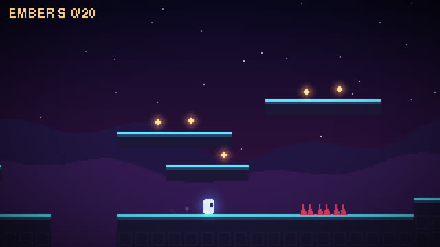
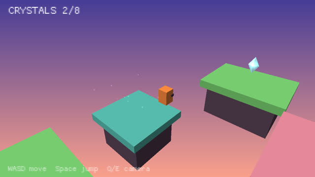
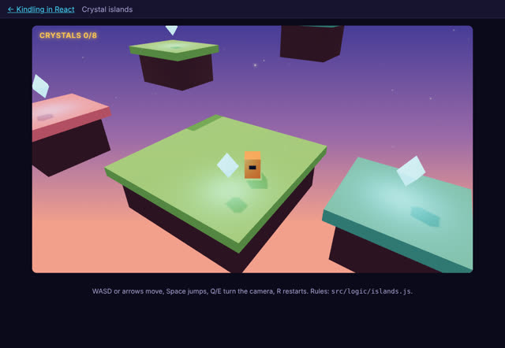
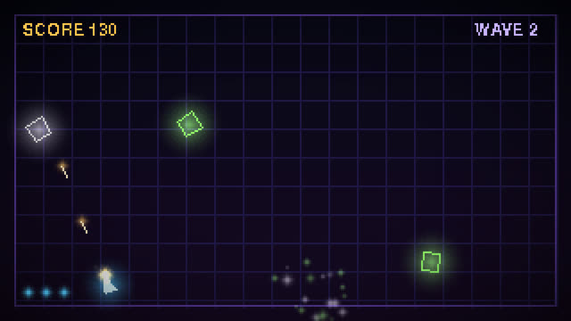
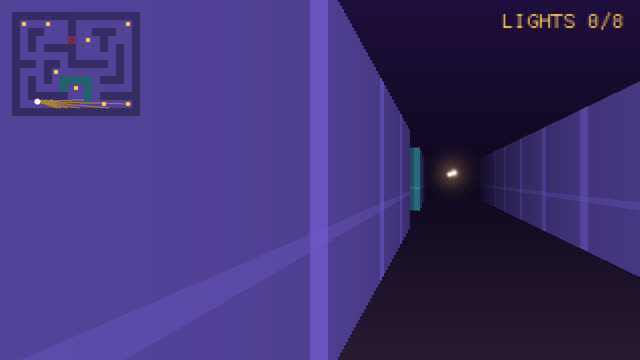
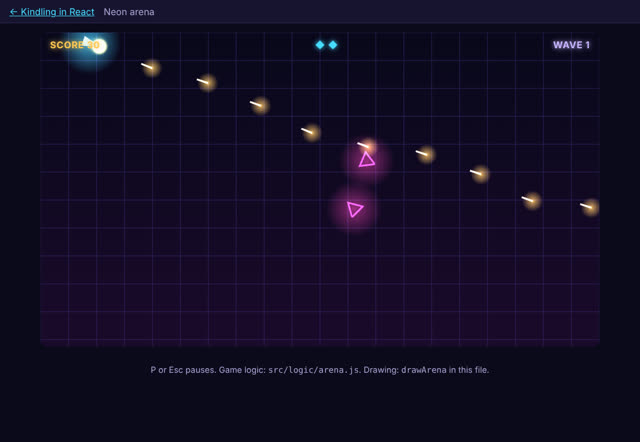

# references/

Complete, good-looking games that use Kindling's engine ideas in **Python**, **Rust** and **React**. Use them as reference code when you build games in those languages.

The rest of Kindling stays zero-dependency JavaScript. Each folder here has its own packages and run steps, and the engine never imports anything from `references/` ([decision D9](../docs/DECISIONS.md)).

| Folder | Built with | Games and demos | Tests |
|---|---|---|---|
| [python/](python/) | pygame-ce | Neon platformer, Neon arena, Raycast halls, Fireworks | 18 (`python -m unittest`) |
| [rust/](rust/) | macroquad | Neon platformer, Crystal islands 3D, Raycast halls, Fireworks | 14 (`cargo test`) |
| [react/](react/) | React, react-three-fiber, Vite | Neon arena, Crystal islands 3D, Easing playground | 6 (`npm test`) |

| Python | Rust | React |
|---|---|---|
|  |  |  |
|  |  |  |

## Same game, three languages

Read one idea across languages and the idea separates from the syntax:

| Idea | JavaScript (engine) | Python | Rust | React |
|---|---|---|---|---|
| Fixed timestep | `engine/core/loop.js` | `kindling_ref/loop.py` | `src/fixed_step.rs` | `src/hooks/useFixedStep.js` |
| Input actions | `engine/input/actions.js` | `kindling_ref/actions.py` | `src/actions.rs` | `src/logic/actions.js` |
| Tile collision | `engine/2d/collision.js` | `kindling_ref/collision.py` | `src/collision.rs` | (3D: `src/logic/islands.js`) |
| Camera and shake | `engine/2d/camera.js` | `kindling_ref/camera.py` | `src/camera.rs` | `drawArena` in `NeonArena.jsx` |
| Particles | `engine/2d/particles.js` | `kindling_ref/particles.py` | `src/particles.rs` | `src/logic/arena.js` |
| Raycaster | `engine/3d/raycaster.js` | `kindling_ref/raycast.py` | `src/raycast.rs` | |
| Platformer | `samples/2d/04-platformer` | `games/neon_platformer.py` | `examples/neon_platformer.rs` | |
| 3D collector | `samples/3d/04-coin-collector` | | `examples/crystal_islands_3d.rs` | `src/demos/CrystalIslands.jsx` |

The smaller, standard-library-only versions of these ideas are in [docs/bridges/](../docs/bridges/).

## Quick start (WSL Ubuntu)

```bash
cd ~/projects/kindling/references/python && python3 -m venv .venv && . .venv/bin/activate && pip install -r requirements.txt && python -m games.neon_platformer
```

```bash
cd ~/projects/kindling/references/rust && cargo run --release --example crystal_islands_3d
```

```bash
cd ~/projects/kindling/references/react && npm install && npm run dev
```

Each folder's README covers installing Python, Rust or Node if you don't have them.
