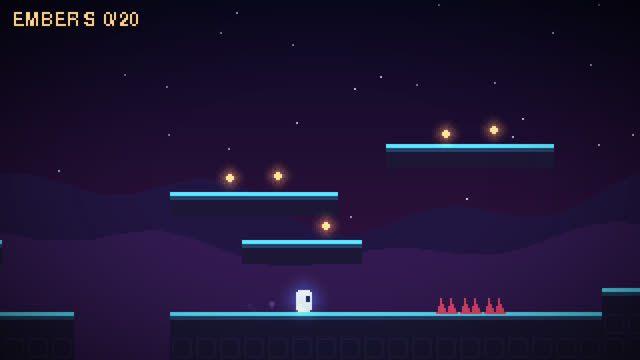
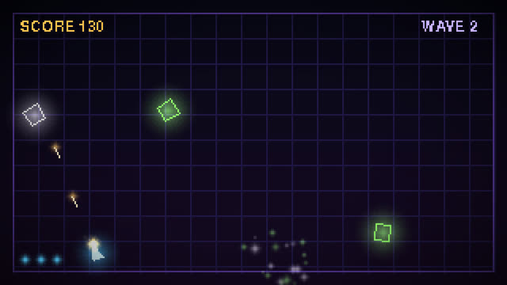
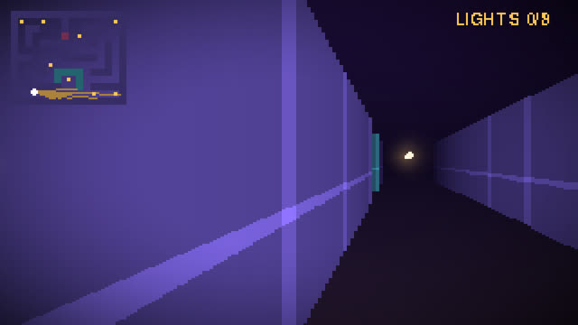
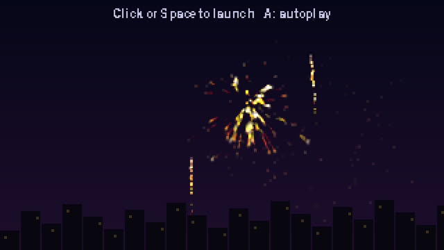

# Python reference (pygame-ce)

Kindling's engine ideas rebuilt in Python, plus four complete games that look good enough to show people. Read a game here next to its JavaScript twin in `samples/` and the idea stands out from the syntax.

| | |
|---|---|
|  **Neon platformer** `games/neon_platformer.py` |  **Neon arena** `games/neon_arena.py` |
|  **Raycast halls** `games/raycast_halls.py` |  **Fireworks** `games/fireworks.py` |

## Run it (WSL Ubuntu, macOS or Linux)

Once, to set up a virtual environment (a private folder of Python packages for this project):

```bash
cd ~/projects/kindling/references/python && python3 -m venv .venv && . .venv/bin/activate && pip install -r requirements.txt
```

Then play any game (Windows 11 shows the window through WSLg):

```bash
cd ~/projects/kindling/references/python && . .venv/bin/activate && python -m games.neon_platformer
```

Swap `neon_platformer` for `neon_arena`, `raycast_halls` or `fireworks`. Each file's top comment lists its keys. Esc quits.

Run the tests (18 checks; the 4 game checks run with no window and are skipped if pygame-ce is missing):

```bash
cd ~/projects/kindling/references/python && . .venv/bin/activate && python -m unittest -v
```

If `python3 -m venv` fails on Ubuntu, install it with `sudo apt install python3-venv`.

## What's where

| File | Idea | JavaScript twin |
|---|---|---|
| `kindling_ref/loop.py` | Fixed timestep with an accumulator | `engine/core/loop.js` |
| `kindling_ref/actions.py` | Named actions; presses remembered until the next step | `engine/input/actions.js` |
| `kindling_ref/easing.py` | clamp, lerp, frame-rate-independent `damp`, easing curves | `engine/math/easing.js` |
| `kindling_ref/collision.py` | Box and circle overlap, move one axis at a time through tiles | `engine/2d/collision.js` |
| `kindling_ref/tilemap.py` | Levels written as text | `engine/2d/tilemap.js` |
| `kindling_ref/camera.py` | Damped follow, world bounds, trauma-based screen shake | `engine/2d/camera.js` |
| `kindling_ref/particles.py` | Bursts with speed, life, gravity and drag | `engine/2d/particles.js` |
| `kindling_ref/raycast.py` | DDA raycasting with fish-eye correction | `engine/3d/raycaster.js` |
| `kindling_ref/app.py` | Window, pixel scaling, input events, the loop (pygame-ce) | `engine/game.js` |
| `kindling_ref/fx.py` | Gradients, additive glows, vignette, text (pygame-ce) | `engine/2d/draw.js` |

The first eight files never import pygame, so you can test them and reuse them with any library (Arcade, pyglet, or a server that simulates a game).

## The tricks worth stealing

- **Additive glow.** `fx.add_glow` blits a soft circle with `special_flags=pygame.BLEND_ADD`. Light adds up, so overlapping glows get brighter. That one flag is most of the neon look.
- **Trails without extra work.** `fireworks.py` dims last frame's canvas with `BLEND_RGB_SUB` instead of clearing it.
- **Forgiving jumps.** `neon_platformer.py` has coyote time, a jump buffer and a short hop when you let go early. All three are a few lines in `update()`.
- **Hit-stop and shake.** `neon_arena.py` pauses the action for 30 to 120 ms on big hits and adds "trauma" that the camera turns into shake.
- **Billboards behind walls.** `raycast_halls.py` keeps one wall distance per column and skips sprite pixels that are further away.
- **Headless runs.** `App.run(max_frames=..., script=...)` plays a game with no window and fake input. That is how the tests work, and how these screenshots were made.

## Going further in Python

- [pygame-ce documentation](https://pyga.me/docs/)
- [Arcade](https://api.arcade.academy/), a modern Python 2D library with built-in physics and cameras
- [docs/bridges/python.md](../../docs/bridges/python.md), the smaller standard-library-only version of these ideas
