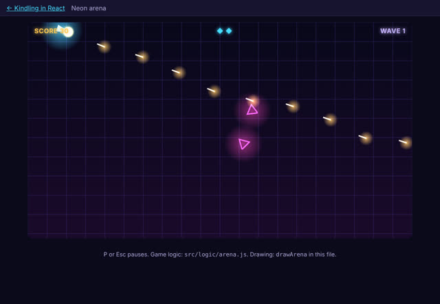
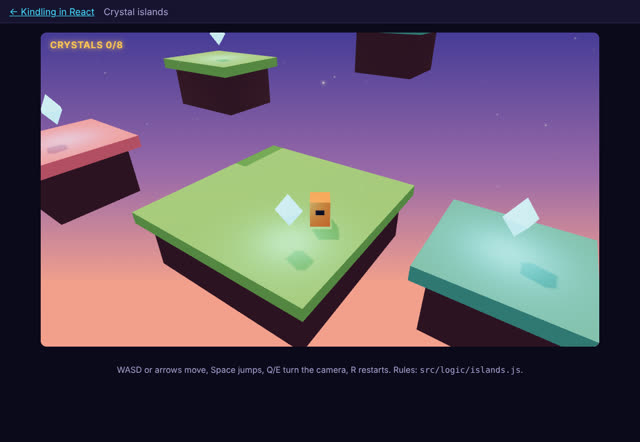
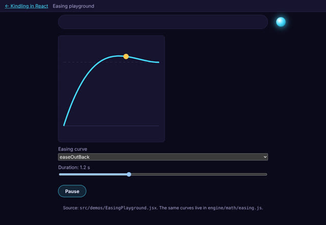
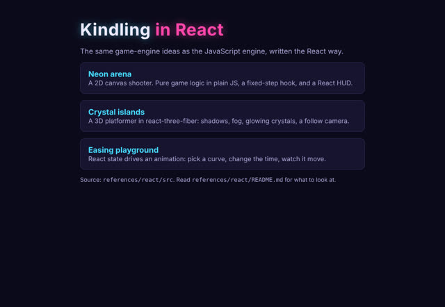

# React reference (React + react-three-fiber)

Kindling's engine ideas written the React way: a 2D canvas shooter, a 3D platformer built with [react-three-fiber](https://r3f.docs.pmnd.rs/), and an easing playground. Each one shows where game state should live in a React app, which is the part most tutorials get wrong.

**Play online** (after you publish): <https://normansrule.github.io/kindling/references/react/dist/>

| | |
|---|---|
|  **Neon arena** `src/demos/NeonArena.jsx` |  **Crystal islands** `src/demos/CrystalIslands.jsx` |
|  **Easing playground** `src/demos/EasingPlayground.jsx` |  **Menu** `src/App.jsx` |

## Run it (WSL Ubuntu, macOS or Linux)

You need Node 18 or newer (`node --version`). Install the packages once:

```bash
cd ~/projects/kindling/references/react && npm install
```

Start the dev server, then open <http://localhost:5173/> (edits reload instantly):

```bash
cd ~/projects/kindling/references/react && npm run dev
```

Run the logic tests (6 checks, plain Node, no browser) and make a production build in `dist/`:

```bash
cd ~/projects/kindling/references/react && npm test && npm run build
```

Unlike the rest of Kindling, this folder has dependencies (React, three.js) and a build step (Vite). The engine never imports it. GitHub Pages builds it automatically on every push.

## Where state lives: the one rule

| Kind of state | Changes | Lives in | Example |
|---|---|---|---|
| Positions, bullets, particles | 60 times a second | a `useRef`, stepped by `useFixedStep` or `useFrame` | `gameRef.current` in `NeonArena.jsx` |
| HUD numbers | a few times a minute | `useState`, set only when the value changes | `hud` in `NeonArena.jsx` |
| Screens and menus | when the player clicks | `useState`, ordinary React UI | `screen` ("start", "paused", "over") |

If game state were in `useState`, React would re-render the whole component tree 60 times a second, and the game would stutter.

## What's where

| File | Idea | JavaScript twin |
|---|---|---|
| `src/hooks/useFixedStep.js` | Fixed-timestep loop on requestAnimationFrame; StrictMode-safe | `engine/core/loop.js` |
| `src/hooks/useActions.js` | Keyboard actions in a ref; releases keys when the window loses focus | `engine/input/actions.js` |
| `src/logic/arena.js` | All of Neon arena's rules as plain functions on a plain object | `samples/2d/05-top-down-shooter` |
| `src/logic/islands.js` | 3D level data and axis-separated box collision for the player | `engine/3d/collision3d.js` |
| `src/logic/random.js` | Seeded random numbers, so tests repeat | `engine/math/random.js` |
| `src/demos/CrystalIslands.jsx` | react-three-fiber: shadows, fog, lights, a follow camera, a fixed step inside `useFrame` | `samples/3d/04-coin-collector` |

`src/logic/` never imports React, so `tests/logic.test.js` runs it in Node, and you could reuse it in React Native or on a server.

## The tricks worth stealing

- **Refs for the loop's callbacks.** `useFixedStep` stores `update` and `render` in refs, so the loop starts once and never restarts on re-render.
- **Set state only on change.** `setHud(current => same ? current : next)` returns the same object when nothing changed, so React skips the render.
- **Fixed steps inside `useFrame`.** `CrystalIslands.jsx` keeps an accumulator in `useFrame`, so jumps are the same height at 60 Hz and 144 Hz.
- **Mutate three.js objects, don't re-render.** `body.position.set(...)` in `useFrame`, not `<mesh position={state}>`.
- **Lazy-load 3D.** `React.lazy` loads three.js only when the 3D demo opens.
- **A see-through canvas.** The sunset is a CSS gradient behind the WebGL canvas, and the fog matches its bottom color.

## Going further in React

- [react-three-fiber documentation](https://r3f.docs.pmnd.rs/) and [drei](https://drei.docs.pmnd.rs/), its helper components
- [docs/bridges/react.md](../../docs/bridges/react.md), a smaller example that puts the plain Kindling engine inside a React component
