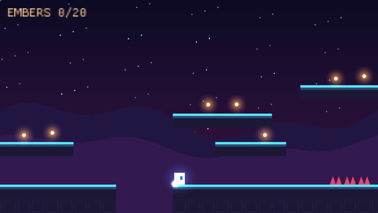
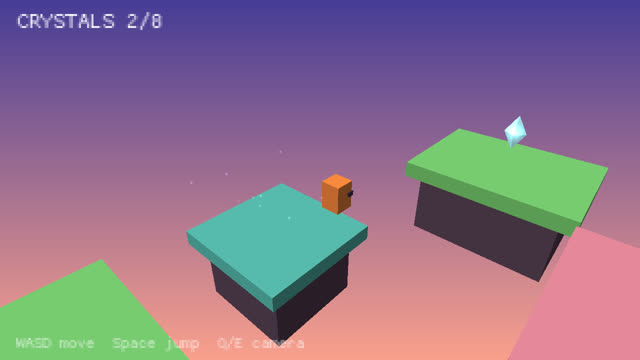
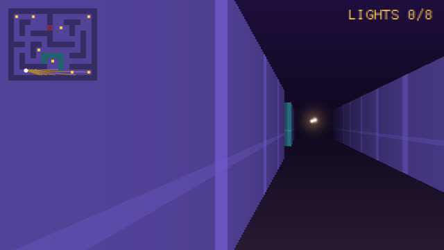
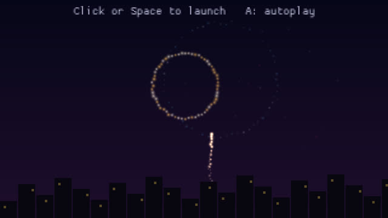

# Rust reference (macroquad)

Kindling's engine ideas as a small, tested Rust library, plus four complete games drawn with [macroquad](https://macroquad.rs/), including a real 3D one.

| | |
|---|---|
|  **Neon platformer** `examples/neon_platformer.rs` |  **Crystal islands 3D** `examples/crystal_islands_3d.rs` |
|  **Raycast halls** `examples/raycast_halls.rs` |  **Fireworks** `examples/fireworks.rs` |

## Run it (WSL Ubuntu, macOS or Linux)

Install Rust once, if `cargo --version` doesn't work (this is the official installer from rustup.rs):

```bash
cd ~ && curl --proto '=https' --tlsv1.2 -sSf https://sh.rustup.rs | sh -s -- -y && . "$HOME/.cargo/env" && cargo --version
```

On Ubuntu, macroquad also needs a C linker and the OpenGL/X11 headers. Install them once:

```bash
cd ~ && sudo apt update && sudo apt install -y build-essential pkg-config libx11-dev libxi-dev libgl1-mesa-dev libasound2-dev
```

Then play (the first build downloads and compiles macroquad, about a minute; Windows 11 shows the window through WSLg):

```bash
cd ~/projects/kindling/references/rust && cargo run --release --example neon_platformer
```

Swap `neon_platformer` for `crystal_islands_3d`, `raycast_halls` or `fireworks`. Each file's top comment lists its keys. Esc quits.

Run the tests (14 checks on the library) and the linter:

```bash
cd ~/projects/kindling/references/rust && cargo test && cargo clippy --all-targets
```

## What's where

| File | Idea | JavaScript twin |
|---|---|---|
| `src/fixed_step.rs` | Fixed timestep that returns a step count (no closure, so no borrow fights) | `engine/core/loop.js` |
| `src/actions.rs` | Named actions; presses remembered until the next step | `engine/input/actions.js` |
| `src/easing.rs` | lerp, frame-rate-independent `damp`, `approach`, easing curves | `engine/math/easing.js` |
| `src/collision.rs` | Box and circle overlap; move one axis at a time through tiles | `engine/2d/collision.js` |
| `src/tilemap.rs` | Levels written as text | `engine/2d/tilemap.js` |
| `src/camera.rs` | Damped follow, world bounds, trauma-based shake | `engine/2d/camera.js` |
| `src/particles.rs` | Bursts with `Burst { count, ..Burst::default() }`, plus a tiny random number generator | `engine/2d/particles.js` |
| `src/raycast.rs` | DDA raycasting with fish-eye correction | `engine/3d/raycaster.js` |
| `examples/common/mod.rs` | Pixel camera, additive glow material, gradients, headless capture (macroquad) | `engine/2d/draw.js` |

The library (`src/`) uses only the standard library, so it works with [Bevy](https://bevy.org/), ggez, or a game server just as well.

## The tricks worth stealing

- **Steps, not closures.** `for _ in 0..stepper.advance(frame_time) { game.update(&actions, step) }` keeps `game` mutably borrowed in one obvious place.
- **One struct owns the game.** Each example has a `Game` with `update` and `draw` methods. No globals, no `Rc<RefCell<...>>`.
- **Additive glow in 30 lines.** `Glow` in `examples/common/mod.rs` loads a material with `BlendFactor::One` as the destination factor, so light adds up.
- **Lighting without shaders.** `crystal_islands_3d.rs` bakes "how much does this face point at the sun" and distance fog into vertex colors, then draws one mesh.
- **3D points to 2D glows.** The same example multiplies a 3D point by the camera matrix to find where to draw its glow on screen.
- **Headless capture.** `KINDLING_FRAMES=240 KINDLING_SHOT=shot.png cargo run --release --example fireworks` runs with an autopilot, saves a PNG and exits. That's how these screenshots were made.

## Going further in Rust

- [macroquad](https://macroquad.rs/) and its [examples](https://macroquad.rs/examples/)
- [Bevy](https://bevy.org/learn/), an ECS (Entity Component System) engine, when your game outgrows one struct
- [docs/bridges/rust.md](../../docs/bridges/rust.md), a smaller walk-through of ownership and traits using these ideas
